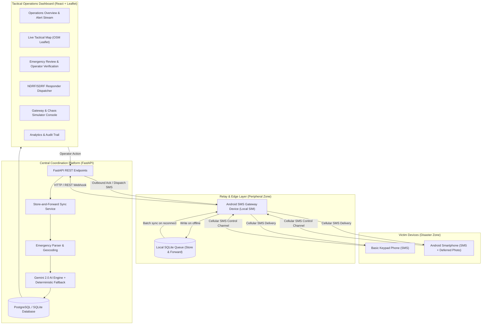

# System Architecture

## Architecture Diagram

## Layer Specifications

### 1. Victim Communication Layer
- Ordinary 2G/3G/4G cellular SMS.
- No client-side software or internet configuration required for keypad phone users.
- Optional deferred smartphone image capture.

### 2. Android Gateway Layer
- Battery-backed Android handset with an active SIM card.
- Implements `BroadcastReceiver` on `SMS_RECEIVED`.
- Local persistent SQLite queue ensures 0-message-drop tolerance when internet fails.
- Batch synchronization endpoint flushes records upon network recovery.

### 3. Backend Coordination Layer
- **FastAPI:** High-throughput async REST framework.
- **SQLAlchemy ORM:** Portable between SQLite and PostgreSQL.
- **Pydantic v2:** Rigorous schema validation and sanitization.
- **RBAC Security:** Role-based access control protecting victim privacy.

### 4. AI Intelligence Layer
- **Google Gemini API:** Multilingual understanding, casualty extraction, priority recommendation, spatial duplicate clustering.
- **Rule-Based Engine:** Zero-dependency fallback guaranteed to function in completely air-gapped environments.

### 5. Frontend Command Center
- **React 18 + Vite + TypeScript:** High-performance single page application.
- **Tailwind CSS:** Modern tactical dark-mode operations interface.
- **Leaflet + OpenStreetMap:** Offline-friendly spatial visualization.
- **Recharts:** Live incident and resource utilization analytics.
